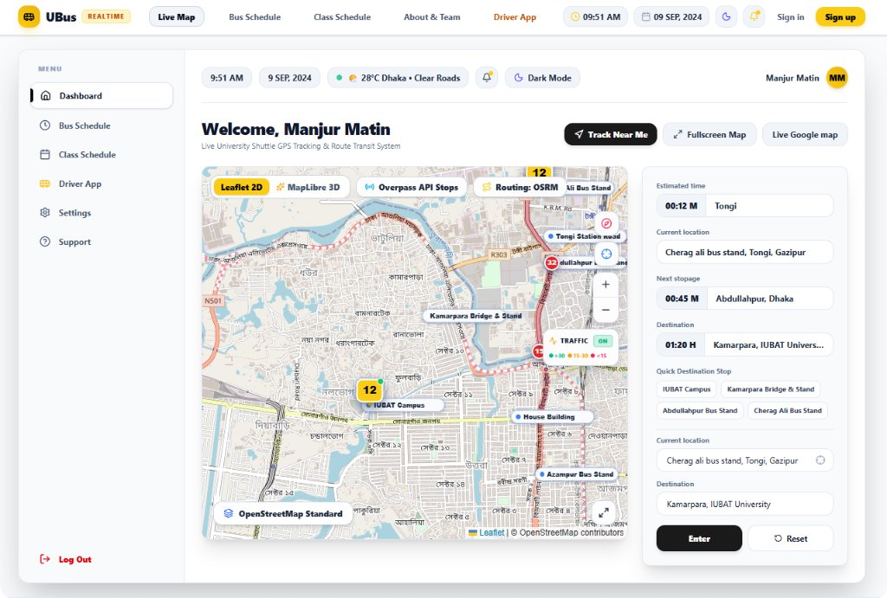

<div align="center">
  
  <h1>UBUS V2</h1>

  <p>
    <a href="https://bus-iubat.vercel.app"></a>
    <a href="https://nextjs.org"></a>
    <a href="https://www.typescriptlang.org"></a>
    <a href="https://tailwindcss.com"></a>
    <a href="https://supabase.com"></a>
    <a href="https://maplibre.org"></a>
    <a href="https://leafletjs.com"></a>
  </p>

  <h3>Real-Time University Bus Tracking, Live Traffic &amp; Smart Campus Commute.</h3>

  <p>
    Track campus buses live on 3D vector or raster maps, check dynamic schedules, and get real-time ETAs.<br />
    Built for students, drivers, and campus transport admins.
  </p>

  <p>
    <a href="https://bus-iubat.vercel.app">
      
    </a>
  </p>

  <br />

  <a href="https://bus-iubat.vercel.app">
    
  </a>
</div>

---

## Why UBUS V2? (Problem & Solution)

- **The Problem:** Students waiting at campus or city bus stops often have no idea where their bus is, whether it is stuck in traffic, or when the next shuttle departs. Static PDFs and guesswork lead to missed buses and wasted time.
- **The Solution:** UBUS V2 streams live bus GPS coordinates via Supabase Realtime onto an interactive 3D MapLibre / Leaflet map, calculates road-accurate ETAs using OSRM, and pairs transit tracking with personalized student class schedules and a dedicated driver cockpit.

---

## Key Features

- **Real-Time Bus Tracking:** Live GPS markers with bus numbers, speed, and instant Supabase Realtime updates.
- **Dual Map Engine (3D & 2D):** Switch seamlessly between MapLibre GL 3D vector maps (OpenFreeMap Liberty, Bright, Positron) and Leaflet raster layers (CartoDB Dark Matter, Voyager, OSM).
- **Road Routing & Traffic Telemetry:** Turn-by-turn OSRM road paths, Overpass API transit stop discovery, and `/api/traffic` ingestion for ESP32 GPS & ESP32-CAM YOLO data.
- **Smart Bus Schedules:** Searchable route timetables, live status indicators, and stop-by-stop pickup sequences.
- **Student Class Schedule:** Day-wise class routine manager with CRUD support and time-left class notifications.
- **Driver Cockpit (`/driver`):** Dedicated driver interface for broadcasting live location and managing active trips.
- **Dark / Light Mode & Mobile Ready:** Responsive desktop dashboard and fullscreen mobile map mode.

---

## Core Modules & Views

| Module | Best For | Key Capabilities |
| :--- | :--- | :--- |
| **Live Map Dashboard** | Students & commuters | Real-time bus markers, GPS "Track Near Me", ETA & route navigation |
| **Driver Cockpit** | Bus drivers (`/driver`) | Live GPS telemetry broadcasting and trip status controls |
| **Bus Schedule** | Daily route planning | Searchable bus routes, departure times, and live status |
| **Class Schedule** | Student time management | ID-based class routine, CRUD modal, and class countdown alerts |
| **Notice Board & Auth** | Campus updates & access | Transport announcements and student/admin authentication |
| **Traffic API** | IoT & telemetry (`/api/traffic`) | Accepts ESP32 GPS and ESP32-CAM YOLO vehicle count payloads |

---

## Tech Stack & Key Technologies

| Domain / Layer | Technology | Role in UBUS V2 |
| :--- | :--- | :--- |
| **Framework & Engine** | [Next.js 16](https://nextjs.org/) (App Router) & [React 19](https://react.dev/) | Server/client rendering, API routes, and fast client navigation. |
| **Language & Styling** | [TypeScript 5](https://www.typescriptlang.org/) & [Tailwind CSS 4](https://tailwindcss.com/) | Type-safe components and responsive dark/light UI styling. |
| **Backend & Realtime** | [Supabase](https://supabase.com/) (`@supabase/supabase-js`) | PostgreSQL database, WebSocket live bus location updates, and authentication. |
| **3D Vector Maps** | [MapLibre GL](https://maplibre.org/) (`maplibre-gl`) | Hardware-accelerated 3D vector map rendering with OpenFreeMap styles. |
| **2D Raster Maps** | [Leaflet](https://leafletjs.com/) & [React Leaflet](https://react-leaflet.js.org/) | Interactive raster tile maps, custom bus DivIcons, and route polylines. |
| **Routing & Geodata** | [OSRM](https://project-osrm.org/) & [Overpass API](https://overpass-api.de/) | Road-snapped turn-by-turn routing, ETA calculation, and transit stop lookup. |
| **Icons & Utilities** | [Lucide React](https://lucide.dev/), `clsx`, `tailwind-merge` | Crisp iconography and clean conditional class composition. |
| **Linting & Quality** | [ESLint 9](https://eslint.org/) (`eslint-config-next`) | Code quality and Next.js best-practice enforcement. |

---

## Quick Start & Local Setup

```bash
# 1. Clone the repository
git clone https://github.com/inbox-hasibur/ubus-v2-realtime-bus-tracking.git
cd ubus-v2-realtime-bus-tracking

# 2. Install dependencies
npm install

# 3. Configure environment variables
cp .env.example .env.local
# Add your NEXT_PUBLIC_SUPABASE_URL and NEXT_PUBLIC_SUPABASE_ANON_KEY

# 4. Start development server
npm run dev
```

Open [http://localhost:3000](http://localhost:3000) in your browser.

---

## Documentation

- **[Changelog](documentation/CHANGELOG.md)** — Version history and release notes.
- **[Developer Guide](documentation/DEVELOPER_GUIDE.md)** — Architecture, project structure, and implementation notes.
- **[Agent Instructions](AGENTS.md)** — Repository workflow and commit conventions.

---

## License

- **Author & Maintainer:** [IncodeBD / Hasibur](https://github.com/inbox-hasibur)
- **Live App:** [bus-iubat.vercel.app](https://bus-iubat.vercel.app)
